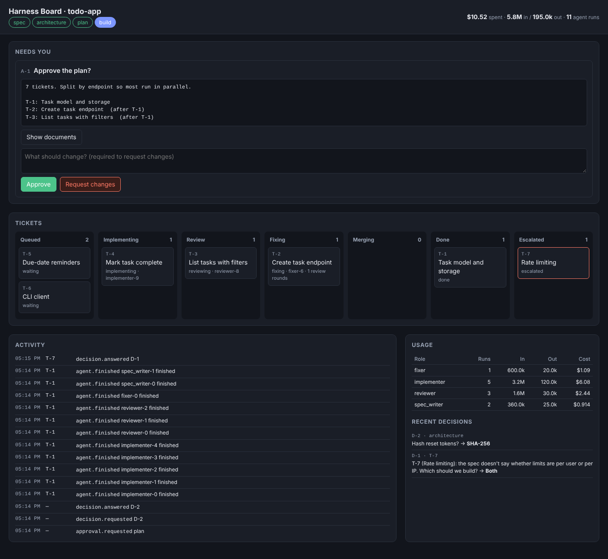
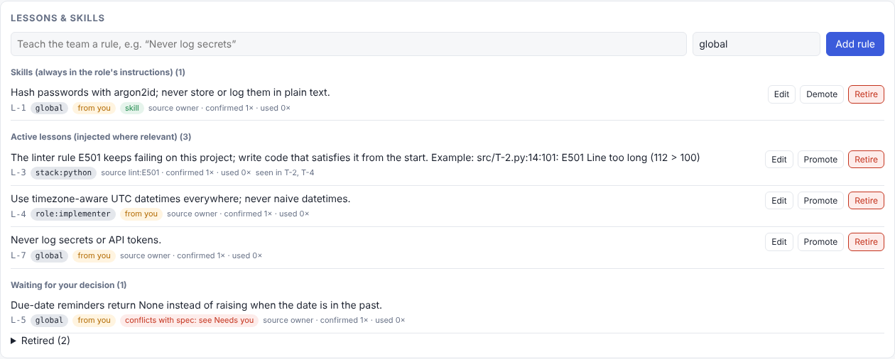

# claude-sandbox: Software Development Harness

A spec-driven, ticket-based, multi-agent software development harness. You
approve a detailed spec; agents break it into small tickets, implement them in
isolated worktrees, review each other's work, fix review findings test-first,
and merge into `main`. Only real decisions are escalated to you, each with
options and pros/cons. See [`docs/PLAN.md`](docs/PLAN.md) for the full design.

## Status

**M0 – Foundations** (done): config with a model per role, provider-neutral model layer,
confined executor + per-ticket git worktrees, SQLite ticket board (atomic claims,
leases, file ownership, dependencies, escalation, event log), language-agnostic Stack
Profiles (`python`, `cpp-cmake`), CLI.

**M1 – Build loop** (done):

- `harness.models.anthropic`: Claude adapter (streaming, prompt caching, effort,
  server-side refusal fallbacks, thinking blocks passed back unchanged)
- `harness.agents.loop`: the tool-use loop; agents end by calling a structured `finish`
  that the harness validates (e.g. by running the gates), with retries and backoff
- `harness.tools`: scoped tools (read/write/edit only in the ticket's scope, shared
  files only via replayable `edit_shared_file`, tests, lint, typecheck)
- `harness.gates`: scope, required tests, configure/build/typecheck/lint/test per stack,
  auto-formatting, and **red→green TDD enforcement** for every bug finding
- `harness.context`: minimal context packs (only the referenced spec sections,
  contracts, files in scope, conventions, lessons) with a token budget
- `harness.core`: event-driven orchestrator with hooks
  (ready → Implementer, awaiting_review → Reviewer, changes_requested → Fixer,
  approved → merge queue), heartbeats, crash recovery, and a merge queue that gates
  the exact merged commit before `main` moves
- `harness run`: run the build loop until no work is left

**M2 – Upstream phases** (done):

- `harness.escalation`: Board decisions. A question to the human cannot be created
  without at least two options, each with pros and cons, and a recommendation. Every
  decision is recorded on the board; a terminal channel (`CliHuman`) answers them.
- `harness.phases`: the waterfall pipeline, each phase ending at an approval gate where
  rejection feedback starts another round:
  1. **spec**: Spec Writer interviews you (via decisions) and writes `docs/spec.md` with
     stable ids (G-, US-, AC-, NFR-, C-, OOS-); the spec linter (no open questions, ids
     unique, required sections) and a Spec Critic push back before you see it
  2. **architecture**: Architect writes `docs/architecture.md` (named interface
     contracts), `docs/conventions.md` and a skeleton that must pass its gates; picks stacks
  3. **plan**: Decomposer writes tickets; the ticket linter (size, ownership, shared files,
     tests, spec coverage of every AC, contracts, dependencies, cycles, readable files,
     context budget) and a Plan Critic push back; approved tickets go on the board
- CLI: `harness start "idea"` runs every remaining phase and then the build loop;
  `harness spec|architecture|plan|status|decisions`

**M3 – The Board** (done):



- `harness dashboard` (or automatically with `harness start`): a local web UI at
  http://127.0.0.1:8765 with what needs you (approvals and decisions, each option with
  pros/cons, its action and the recommendation), the ticket board, a live activity
  feed, ticket timelines and agent transcripts, and token usage and cost
- One channel to the human through the board: answer on the dashboard, with
  `harness answer D-3 2 "note"` / `harness approve A-1 [--reject "feedback"]`, or
  interactively with `--interactive`; the waiting pipeline picks the answer up
- Escalations come with options: a **Researcher** agent turns an escalated ticket into
  a decision whose options each carry an action (retry, send to fixer, cancel, manual);
  your answer is applied automatically and your note becomes guidance for the next agent
- `harness usage`: tokens and cost by role and ticket (built-in Claude prices,
  overridable with `pricing:` in config)

**M4 – Learning** (done):



- `harness.learning`: lessons are short rules with a scope (`global`, `role:<role>`,
  `path:<glob>`, `stack:<name>`), learned from the board's event log:
  - your rejection feedback and decision notes become high-priority lessons right away
    (a **Librarian** agent generalizes them; if it can't, your words are kept verbatim)
  - review findings become lessons when they recur (the librarian reinforces or adds)
  - the same lint rule failing on two or more tickets becomes a lesson mechanically
- Each agent gets only the lessons relevant to its role and files (ranked, capped at
  ~1.2k tokens). Lessons confirmed 3 times are promoted into **skills**: part of the
  role's system prompt
- The librarian merges duplicates and retires stale rules; a lesson that contradicts the
  approved spec is held as *pending* and asked about on the Board instead of applied
- Manage everything on the dashboard (add, edit, promote, retire, restore) or with
  `harness lessons`, `harness lesson add|edit|retire|restore|promote`, `harness learn`

Next: **M5 – hardening** (integration/QA phase, more providers, Docker executor, new-language
toolchain agent) and a first real run with your API key.

## Development

```bash
uv sync
uv run pytest -q
uv run ruff check . && uv run ruff format --check . && uv run mypy
```

## Quick try

```bash
uv run harness init /tmp/my-app
cd /tmp/my-app
cat > tickets.yaml <<'YAML'
- id: T-1
  title: Token model
  owned_files: [app/tokens.py]
- id: T-2
  title: Reset endpoint
  depends_on: [T-1]
  owned_files: [app/reset.py]
YAML
uv run --project <path-to-this-repo> harness ticket add tickets.yaml --queue
uv run --project <path-to-this-repo> harness board
export ANTHROPIC_API_KEY=...   # or configure another provider in .harness/config.yaml
uv run --project <path-to-this-repo> harness run

# Or the whole pipeline from an idea (the dashboard opens at http://127.0.0.1:8765):
uv run harness init /tmp/calc && cd /tmp/calc
uv run --project <path-to-this-repo> harness start "A command-line calculator in Python" --watch
```
